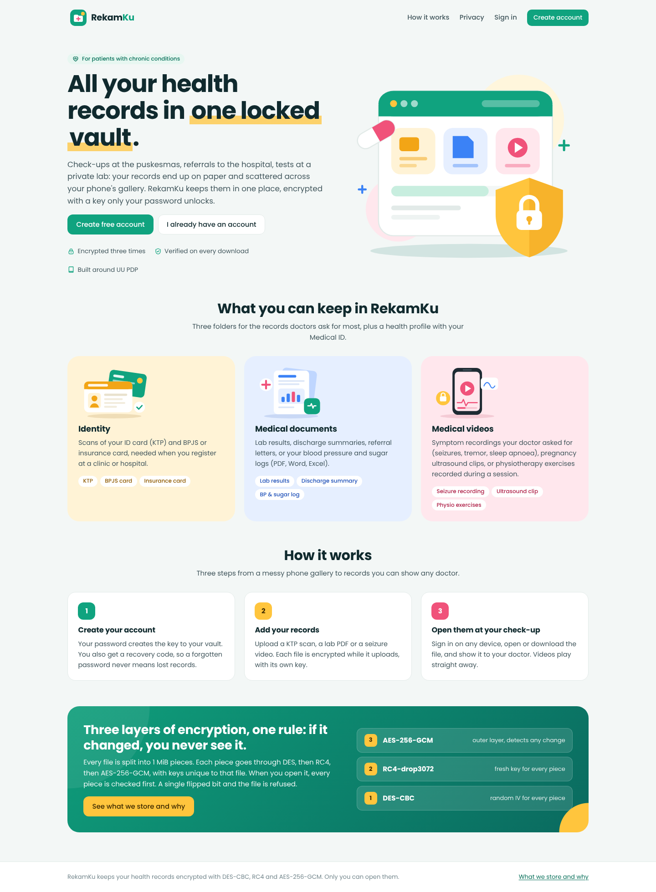
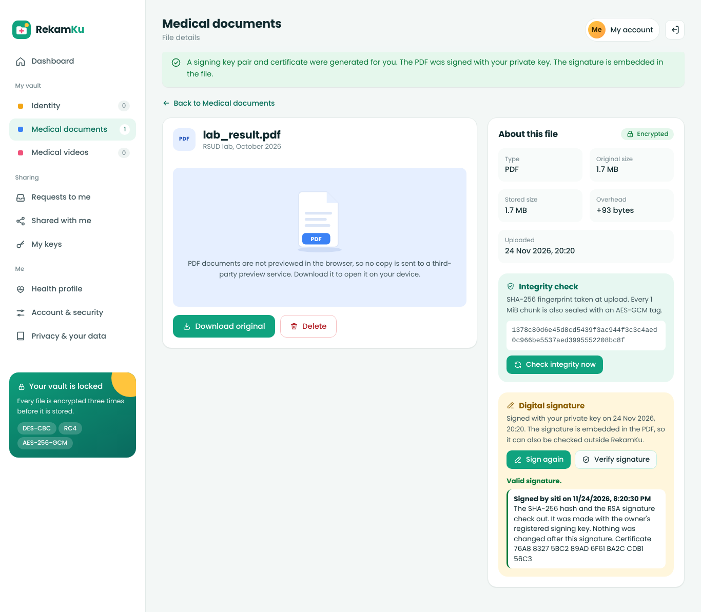
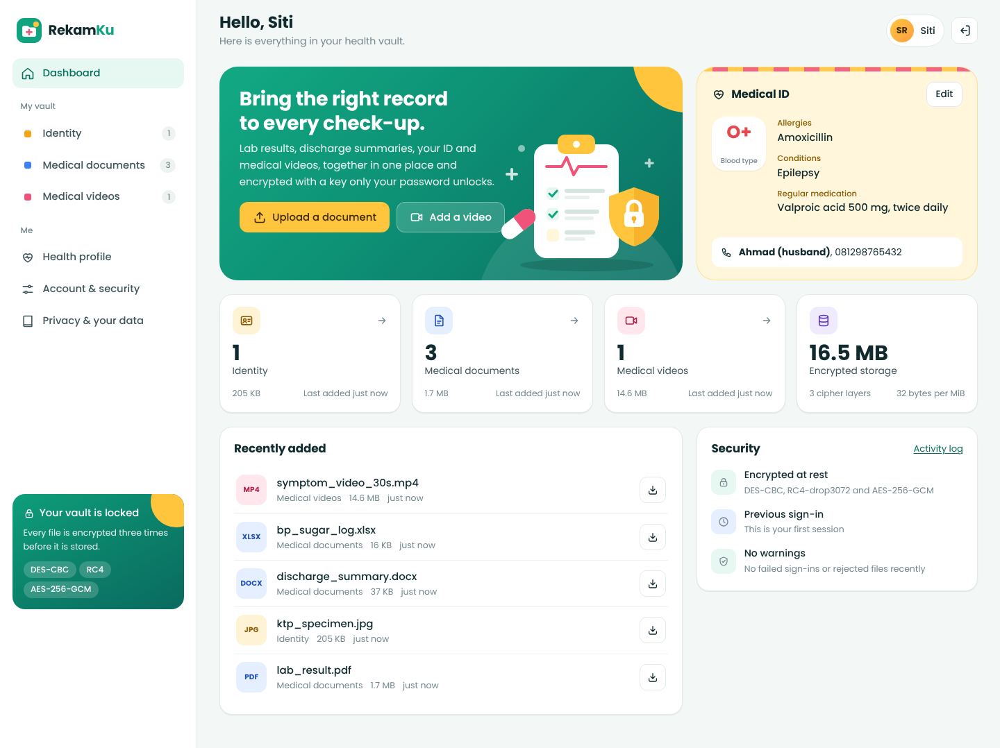

# RekamKu



RekamKu is a small web app where patients with a chronic illness can keep their own medical records in one place.
We picked this scenario because these patients are usually treated at several places (a puskesmas, a hospital, a
private lab), so their lab results, KTP and BPJS scans, and the videos their doctor asks for end up scattered on
paper, in chat apps and in the phone gallery. One lost phone or one message sent to the wrong group is enough to
expose a diagnosis.

In RekamKu a patient stores a health profile, scanned identity documents (KTP, BPJS card), medical documents
(PDF, DOCX, XLSX) and medical videos. Everything is encrypted with three ciphers in a row: DES-CBC, then RC4, then
AES-256-GCM. Only the owner can open their files after signing in, and a file that was changed on disk is refused
instead of being shown.

This started as Assignment 1 (Symmetric Encryption) for the Information Security course. Assignment 2 (Key
Management) adds sharing: a doctor or relative can request access to a patient's records, the patient approves
and RekamKu generates a symmetric share key, and the patient sends that key to them by WhatsApp or e-mail,
encrypted with their RSA public key. Design details are in [`docs/KEY_MANAGEMENT.md`](docs/KEY_MANAGEMENT.md).

Assignment 3 (Digital Signature) lets a patient sign their PDF documents with their own private key. The
signature is embedded in the PDF as a standard PDF signature, so RekamKu, a doctor the file is shared with, and
third-party readers such as Adobe Acrobat or poppler's `pdfsig` can all verify it. The DER, X.509, CMS and RSA
PKCS#1 v1.5 code that builds and checks the signature is our own; libraries are only used to generate keys, to
hash, and to read the PDF structure. Design details are in [`docs/DIGITAL_SIGNATURES.md`](docs/DIGITAL_SIGNATURES.md).



Live demo: https://rekamku26.pythonanywhere.com/ (use fictional data only).

## Team 10

| Name | NRP |
|---|---|
| Kartika Nana Naulita | 5025241021 |
| Safa Mashita | 5025241022 |
| Devina Balqis Aurora | 5025241034 |
| Via Hana Nurma Putri | 5025241048 |

The report is in [`docs/Report_RekamKu.pdf`](docs/Report_RekamKu.pdf). How we used AI is described in
[`docs/AI_USAGE.md`](docs/AI_USAGE.md).



## How to run

We used Python 3.13. On Windows, activate the virtual environment with `.venv\Scripts\activate`
instead of the `source` command.

```bash
python -m venv .venv && source .venv/bin/activate
pip install -r requirements.txt
python run.py
```

Then open http://127.0.0.1:5000. Running `python run.py --https` starts the app with a self-signed certificate at
https://127.0.0.1:5443.

The first run creates an `instance/` folder with the database, the encrypted files and a server secret
(`server.key`). This folder is ignored by git and should never be pushed. By default the server secret sits on the
same disk as the database. On a real server it should be given through the `REKAMKU_SERVER_KEY` environment
variable (64 hex characters) instead, so that someone who steals only the database cannot start guessing passwords.

For hosting, use `wsgi.py` with a single process, for example `gunicorn -w 1 --threads 8 wsgi:app`, because the
keys of signed-in users are kept in that process's memory. Set `REKAMKU_HTTPS=1` when the site runs over HTTPS.

## Deployment

The live demo runs on a free PythonAnywhere account. Its WSGI configuration file sets `REKAMKU_HTTPS=1` and `REKAMKU_SERVER_KEY` as environment variables and then loads the app with `create_app()`. A free account runs a single worker and must be renewed every month. RekamKu needs a single process anyway, because signed-in users' keys are kept in memory. The server key must never be committed to git.

## Tests and benchmark

```bash
python -m unittest -v
python bench/make_samples.py
python bench/benchmark.py
python bench/plots.py
python bench/compare.py
python bench/share_bench.py
python bench/sign_bench.py
python bench/plot_sign.py
```

There are 99 tests (49 from Assignment 1, 27 for sharing in `tests/test_sharing.py` and 23 for signatures in
`tests/test_signatures.py`). They check the ciphers against official test vectors, try to open another user's file,
flip bits in stored files, cut files short, swap files between users, and check that nothing personal is stored
in plain text.

The benchmark encrypts fictional sample files that look like what a patient would upload (a KTP specimen, a lab
PDF, a DOCX, an XLSX and two videos) and writes the results to `bench/results/`. It takes about 15 minutes. We ran
it twice on our laptop: the first run is in `bench/results_1/`, the second in `bench/results/`, and
`bench/compare.py` shows how much the two runs differ.

`bench/share_bench.py` (Assignment 2) measures the cost of sharing and runs 15 attack scenarios against the
sharing feature (intercepted or edited tokens, revoked and expired shares, a stolen database, a swapped public key).
It writes `bench/results/e8_share_cost.csv` and `bench/results/e9_share_attacks.csv`. Run `make_samples.py` first.

`bench/sign_bench.py` (Assignment 3) measures signing and verification and runs 12 attack scenarios against signed
PDFs (a flipped bit, content added after signing, a forged signature under the same name, a removed or transplanted
signature, an edited byte range, a stolen database), comparing RekamKu's verdict with poppler `pdfsig`. It writes
`bench/results/e10_sign_cost.csv` and `bench/results/e11_sign_attacks.csv`.

## Results of the cipher comparison

We measured encryption time, the share of each cipher in the cascade, server memory, and tamper detection on fictional files that look like a patient's uploads (from a 16 KB XLSX to a 90 MB video). **AES-256-GCM is the cheapest layer and the only one that detects tampering**; on the 90 MB video it is about 70 times faster than DES and about 5 times faster than RC4, while DES alone takes about nine tenths of the cascade time. For this reason the security of RekamKu rests on AES-256-GCM, and DES and RC4 are included because the assignment requires them.

## How it works

### Files and folders

```
app/
  crypto/primitives.py   AES-256-GCM, DES-CBC and RC4 (using the cryptography library)
  crypto/cascade.py      the encrypted file format: 1 MiB chunks, DES-CBC -> RC4 -> AES-GCM
  crypto/keys.py         password hashing (scrypt), key wrapping, recovery codes
  crypto/asym.py         RSA-OAEP share-key tokens (Assignment 2)
  crypto/der.py          DER encoder and decoder (Assignment 3)
  crypto/rsasig.py       RSA PKCS#1 v1.5 signatures with CRT and blinding (Assignment 3)
  crypto/x509.py         self-signed X.509 certificates (Assignment 3)
  crypto/cms.py          CMS SignedData, detached (Assignment 3)
  crypto/pdfsign.py      PDF signing as an incremental update, and verification (Assignment 3)
  views/auth.py          register, sign in, sign out, recover with a recovery code
  views/vault.py         dashboard, folders, upload, download, video seeking, integrity check, delete
  views/profile.py       health profile
  views/account.py       change password, new recovery code, activity log, delete account
  views/sharing.py       access requests, share keys, shared records (Assignment 2)
  views/keys.py          My keys page (Assignment 2 and 3)
  views/signing.py       sign a PDF, verify signatures, signing key and certificate (Assignment 3)
  catalog.py             file categories and profile fields with their UU PDP classification
  templates/, static/    pages, CSS, JavaScript, font
tests/                   test_crypto.py (20), test_app.py (29), test_sharing.py (27), test_signatures.py (23)
bench/                   benchmark scripts and results
docs/                    report, AI usage, AI screenshots, app screenshots
```

### Keys

Each user has a random account key (UMK), and each file has its own random file key (FEK).

* The password goes through scrypt together with a server secret (the pepper). The result unlocks the UMK.
* The UMK unlocks the file keys, and each file key encrypts one file.
* A recovery code, shown once at registration, can also unlock the UMK. A forgotten password therefore does not
  mean lost medical records.
* Changing the password only re-locks the UMK; the files do not have to be encrypted again.
* Deleting a file deletes its key from the database. Older database backups still contain that key.

### Encrypted file format

A stored file starts with a 32-byte header (format name, version, chunk size and a random salt) and is then split
into 1 MiB chunks. Each chunk is encrypted with DES-CBC (random IV), then RC4 (a new key for every chunk), then
AES-256-GCM. The GCM nonce is the chunk number.

Every chunk is also tied to its owner, its file ID, its position and whether it is the last chunk. Because of
that, changing a byte, reordering chunks, cutting the file short or moving a file to another user all make
decryption fail. When a file is opened, the GCM check runs first, before DES or RC4 are touched.

### What is stored readable

File contents, file names, notes, categories, sizes, upload times, the profile, the username, the account
creation date and the activity log are all encrypted. The only readable values are random IDs, a keyed hash of the
username used to find the account at sign-in, salts and scrypt settings, and the public key used to write the
activity log while the user is signed out. A test checks every database column for this.

## Known limitations

* The server sees the plain file while it is being uploaded or downloaded. This is server-side encryption, not
  end-to-end encryption.
* Keys of signed-in users live in memory, so the app must run as one process, and restarting it signs everyone out.
  Python also cannot fully wipe a key from memory.
* If a chunk fails the check in the middle of a download, the download stops. The user may get an incomplete file,
  but never a modified one.
* An old but valid copy of a record could be put back (rollback) without being noticed, because the chunks do not
  carry a version number.
* `run.py` uses Flask's development server. A real deployment should run behind a proper WSGI server with HTTPS.
* Sharing: public keys come from the server, so someone who can write to the database could swap them. The
  requester's own fingerprint is computed from their private key, so a swap shows up as a mismatch and a warning,
  but only if the two sides compare fingerprints over the phone. Revoking stops access through RekamKu, but cannot take back a
  file the requester already downloaded. The shared health profile is a copy taken at approval time.
* Signatures: the signing key is a self-signed certificate, so readers outside RekamKu show the signer's identity as
  unknown until they trust the certificate (download it from My keys). The signing time comes from the server clock,
  not from a trusted timestamp. The private key is kept encrypted on the server, so a compromised server could sign
  while the patient is signed in. There is no way to revoke a signing key yet.
