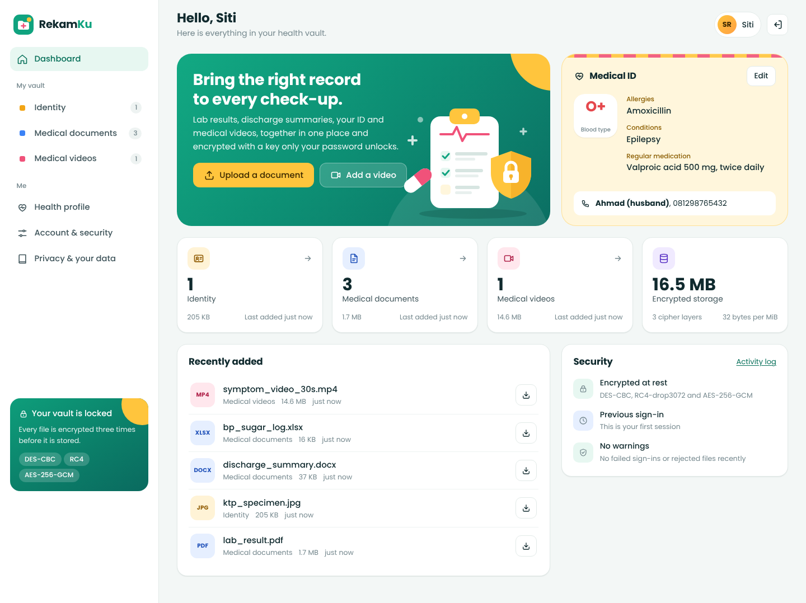

# RekamKu

RekamKu is a small web app where patients with a chronic illness can keep their own medical records in one place.
We picked this scenario because these patients are usually treated at several places (a puskesmas, a hospital, a
private lab), so their lab results, KTP and BPJS scans, and the videos their doctor asks for end up scattered on
paper, in chat apps and in the phone gallery. One lost phone or one message sent to the wrong group is enough to
expose a diagnosis.

In RekamKu a patient stores a health profile, scanned identity documents (KTP, BPJS card), medical documents
(PDF, DOCX, XLSX) and medical videos. Everything is encrypted with three ciphers in a row: DES-CBC, then RC4, then
AES-256-GCM. Only the owner can open their files after signing in, and a file that was changed on disk is refused
instead of being shown.

This is Assignment 1 (Symmetric Encryption) for the Information Security course.

Live demo: https://rekamku.pythonanywhere.com/ (use fictional data only).

## Team

| Name | NRP |
|---|---|
| Kartika Nana Naulita | 5025241021 |
| Safa Mashita | 5025241022 |
| Devina Balqis Aurora | 5025241034 |
| Via Hana Nurma Putri | 5025241048 |

The report is in [`docs/Report_RekamKu.pdf`](docs/Report_RekamKu.pdf). How we used AI is described in
[`docs/AI_USAGE.md`](docs/AI_USAGE.md).



## How to run

We used Python 3.13. On Windows, activate the virtual environment with `.venv\Scripts\activate`
instead of the `source` command.

```bash
python -m venv .venv && source .venv/bin/activate
pip install -r requirements.txt
python run.py
```

Then open http://127.0.0.1:5000. Running `python run.py --https` starts the app with a self-signed certificate at
https://127.0.0.1:5443.

The first run creates an `instance/` folder with the database, the encrypted files and a server secret
(`server.key`). This folder is ignored by git and should never be pushed. By default the server secret sits on the
same disk as the database. On a real server it should be given through the `REKAMKU_SERVER_KEY` environment
variable (64 hex characters) instead, so that someone who steals only the database cannot start guessing passwords.

For hosting, use `wsgi.py` with a single process, for example `gunicorn -w 1 --threads 8 wsgi:app`, because the
keys of signed-in users are kept in that process's memory. Set `REKAMKU_HTTPS=1` when the site runs over HTTPS.

## Tests and benchmark

```bash
python -m unittest -v
python bench/make_samples.py
python bench/benchmark.py
python bench/plots.py
python bench/compare.py
```

There are 49 tests. They check the ciphers against official test vectors, try to open another user's file,
flip bits in stored files, cut files short, swap files between users, and check that nothing personal is stored
in plain text.

The benchmark encrypts fictional sample files that look like what a patient would upload (a KTP specimen, a lab
PDF, a DOCX, an XLSX and two videos) and writes the results to `bench/results/`. It takes about 15 minutes. We ran
it twice on our laptop: the first run is in `bench/results_1/`, the second in `bench/results/`, and
`bench/compare.py` shows how much the two runs differ.

## How it works

### Files and folders

```
app/
  crypto/primitives.py   AES-256-GCM, DES-CBC and RC4 (using the cryptography library)
  crypto/cascade.py      the encrypted file format: 1 MiB chunks, DES-CBC -> RC4 -> AES-GCM
  crypto/keys.py         password hashing (scrypt), key wrapping, recovery codes
  views/auth.py          register, sign in, sign out, recover with a recovery code
  views/vault.py         dashboard, folders, upload, download, video seeking, integrity check, delete
  views/profile.py       health profile
  views/account.py       change password, new recovery code, activity log, delete account
  catalog.py             file categories and profile fields with their UU PDP classification
  templates/, static/    pages, CSS, JavaScript, font
tests/                   test_crypto.py (20 tests), test_app.py (29 tests)
bench/                   benchmark scripts and results
docs/                    report, AI usage, AI screenshots, app screenshots
```

### Keys

Each user has a random account key (UMK), and each file has its own random file key (FEK).

* The password goes through scrypt together with a server secret (the pepper). The result unlocks the UMK.
* The UMK unlocks the file keys, and each file key encrypts one file.
* A recovery code, shown once at registration, can also unlock the UMK. A forgotten password therefore does not
  mean lost medical records.
* Changing the password only re-locks the UMK; the files do not have to be encrypted again.
* Deleting a file deletes its key from the database. Older database backups still contain that key.

### Encrypted file format

A stored file starts with a 32-byte header (format name, version, chunk size and a random salt) and is then split
into 1 MiB chunks. Each chunk is encrypted with DES-CBC (random IV), then RC4 (a new key for every chunk), then
AES-256-GCM. The GCM nonce is the chunk number.

Every chunk is also tied to its owner, its file ID, its position and whether it is the last chunk. Because of
that, changing a byte, reordering chunks, cutting the file short or moving a file to another user all make
decryption fail. When a file is opened, the GCM check runs first, before DES or RC4 are touched.

### What is stored readable

File contents, file names, notes, categories, sizes, upload times, the profile, the username, the account
creation date and the activity log are all encrypted. The only readable values are random IDs, a keyed hash of the
username used to find the account at sign-in, salts and scrypt settings, and the public key used to write the
activity log while the user is signed out. A test checks every database column for this.