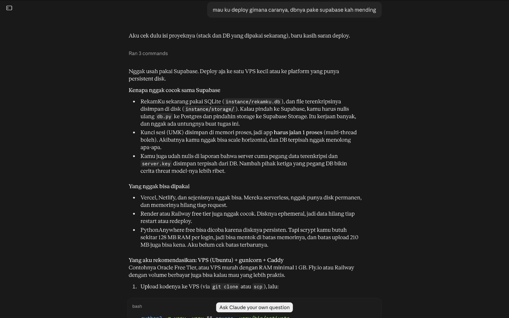
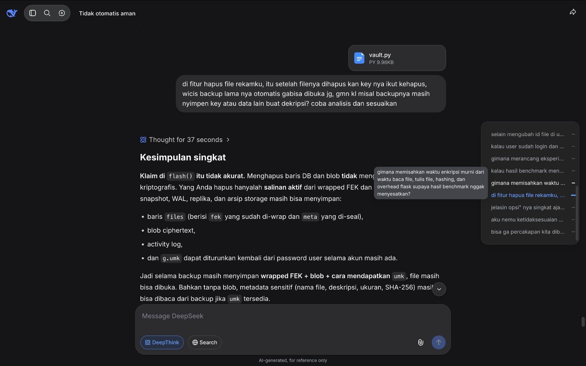
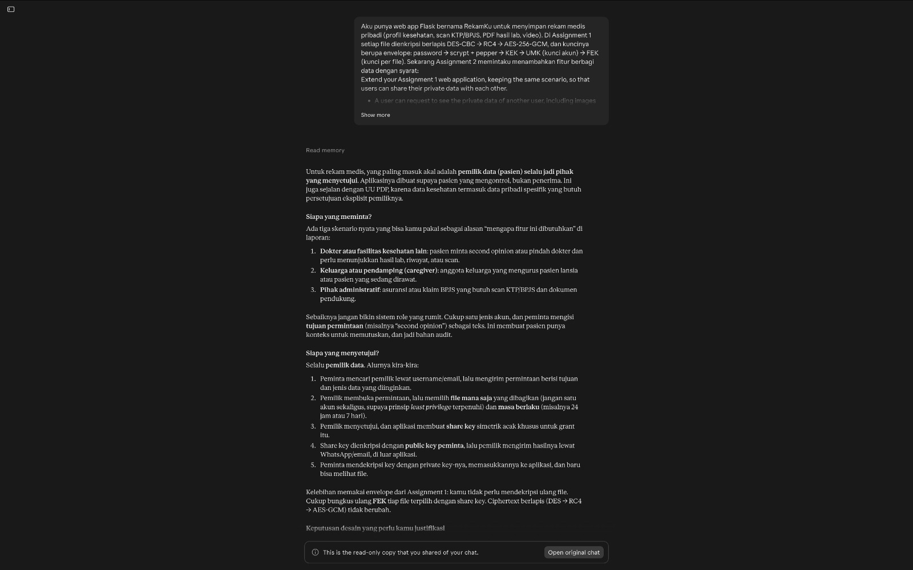
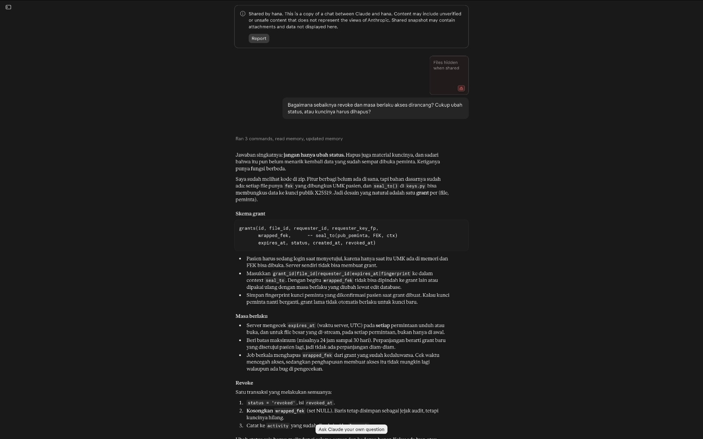

# AI Usage

This file describes how we used AI tools in each assignment of this project: what the AI helped with, what we decided and checked ourselves, and where the conversations are.

---

## Assignment 1 (Symmetric Encryption)

### Tools and conversations

1. **Claude (Anthropic)**
   View AI Conversation: https://claude.ai/share/d9177419-a7c7-4eba-929b-746e8e29564a
   

2. **DeepSeek**
   View AI Conversation: https://chat.deepseek.com/share/4y3nily0ej8cm0xd9v
   

### What the AI helped with

#### Claude

1. Deployment: Claude compared hosting options (Supabase was not suitable for our SQLite and file-based design), prepared the deployment files and guided us step by step through PythonAnywhere.

#### DeepSeek

1. Whether combining AES-GCM, DES-CBC and RC4 in one pipeline is automatically more secure, and how the cipher order, key management and decryption order affect the weaknesses.
2. How to satisfy the assignment requirement to use DES and RC4 without claiming that the system is safe for real medical use.
3. Whether using a different key per layer limits the damage of one compromised key, and whether the cascade really gives a security benefit.
4. Whether a leaked database is safe when the keys are stored separately, and how key rotation can work without re-encrypting every large file (envelope encryption).

### How we checked the AI output

1. We did not accept the AI answers as they were. We tested the ciphers against official test vectors, and our tests try to open another user's file, change stored bytes and cut files short.
2. We compared the legal claims in the report with the text of UU PDP and the GDPR.
3. We checked the benchmark claims against our own measurements and corrected the report where the numbers differed.

---

## Assignment 2 (Key Sharing)

### Tools and conversations

1. **Claude (Anthropic)**
   View AI Conversation: https://claude.ai/share/ceab0f74-1dba-4ecc-af8b-272af4fb9da4
   

2. **Claude (Anthropic)**
   View AI Conversation: https://claude.ai/share/cbcfcb71-d8f9-4a6c-bd26-9f57a9d6ad8a
   

### What the AI helped with

#### Claude

We used Claude to discuss design choices and to review code we had already written. We wrote the feature, tests, benchmark and report ourselves.

Conversation 1 (design of the sharing scheme):

1. The scenario: the patient always approves, and the requester is a doctor, a caregiver or an administrative party.
2. Using one share key per approved request, so a leak or a revoke affects only that request.
3. Wrapping the file key (FEK) with the share key instead of re-encrypting a 90 MB video.
4. Using RSA-OAEP instead of PKCS#1 v1.5 (padding oracle), with one generic error message.
5. Token risks on WhatsApp, and binding the token to one request by putting the request ID inside the ciphertext.
6. Storing the share key wrapped with the patient's UMK, so it can be shown again and revoked.
7. Whether a fingerprint is enough to trust a public key from our own server (only if it is compared over another channel).

Conversation 2 (revocation, migration, code review):

1. How revoke and expiry should work: check expiry on every access and delete the wrapped keys, not only change a status. Revoking cannot take back data that was already opened.
2. How to migrate Assignment 1 accounts that have no RSA key pair: create the key at the next sign-in.
3. A review of the token functions in `asym.py` and of `approve` in `sharing.py` (authorization, input checks, approve/withdraw race, fingerprint check).

What we decided ourselves: we kept RSA-OAEP with one share key per request instead of the per-file grants with X25519 that Claude sketched. The token format, tables, code and report are ours.

### How we checked the AI output

1. We did not accept the AI answers as they were. We compared the suggestions with our own code and kept only what fit RekamKu.
2. We wrote tests for the sharing feature in `tests/test_sharing.py` (token round-trip, wrong private key, token bound to its share, tampered token, only the owner can approve, files of other users cannot be shared, revocation deletes keys, expiry, withdrawal, no plaintext in the new tables, a swapped public key is detected). The whole suite runs with `python -m unittest`.
3. We ran `bench/share_bench.py`, which measures the cost of sharing and runs 15 attack scenarios, including swapping the requester's public key in the database. We used these results, not the AI's claims, in the analysis.
4. We compared the legal claims about consent and health data in the report with the text of UU PDP.
