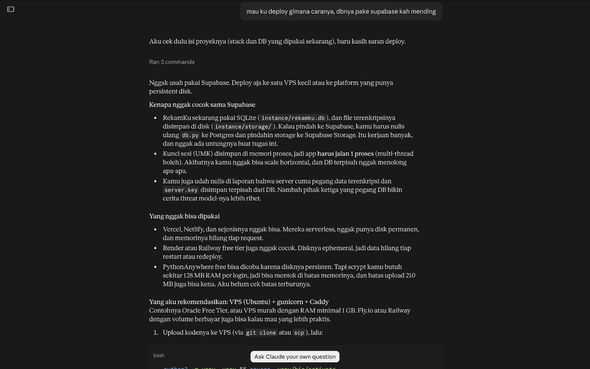
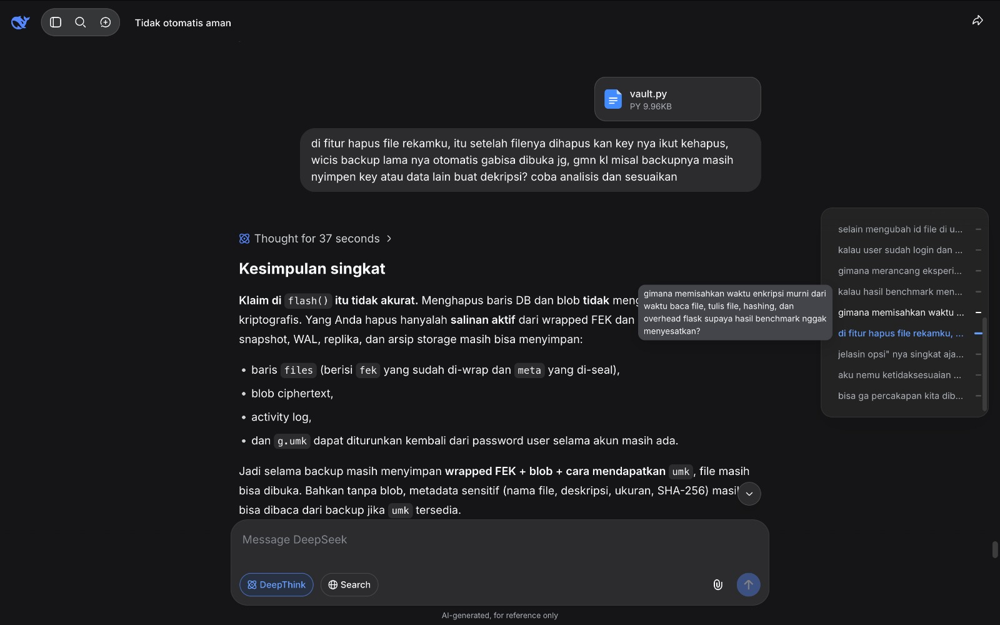

# AI Usage

This file describes how we used AI tools in Assignment 1 (Symmetric Encryption): what the AI helped with, what we decided and checked ourselves, and where the conversations are.

## Tools and conversations

1. **Claude (Anthropic)**
   View AI Conversation: https://claude.ai/share/d9177419-a7c7-4eba-929b-746e8e29564a
     

2. **DeepSeek**
   View AI Conversation: https://chat.deepseek.com/share/4y3nily0ej8cm0xd9v
   

## What the AI helped with

### Claude

1. Deployment, Claude compared hosting options (Supabase was not suitable for our SQLite and file-based design), prepared the deployment files and guided us step by step through PythonAnywhere.

### DeepSeek

1. Whether combining AES-GCM, DES-CBC and RC4 in one pipeline is automatically more secure, and how the cipher order, key management and decryption order affect the weaknesses.
2. How to satisfy the assignment requirement to use DES and RC4 without claiming that the system is safe for real medical use.
3. Whether using a different key per layer limits the damage of one compromised key, and whether the cascade really gives a security benefit.
4. Whether a leaked database is safe when the keys are stored separately, and how key rotation can work without re-encrypting every large file (envelope encryption).

## How we checked the AI output

1. We did not accept the AI answers as they were. We tested the ciphers against official test vectors, and our tests try to open another user's file, change stored bytes and cut files short.
2. We compared the legal claims in the report with the text of UU PDP and the GDPR.
3. We checked the benchmark claims against our own measurements and corrected the report where the numbers differed.
